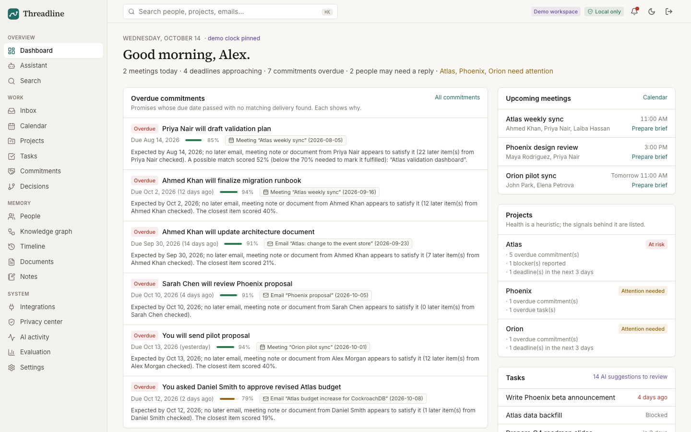
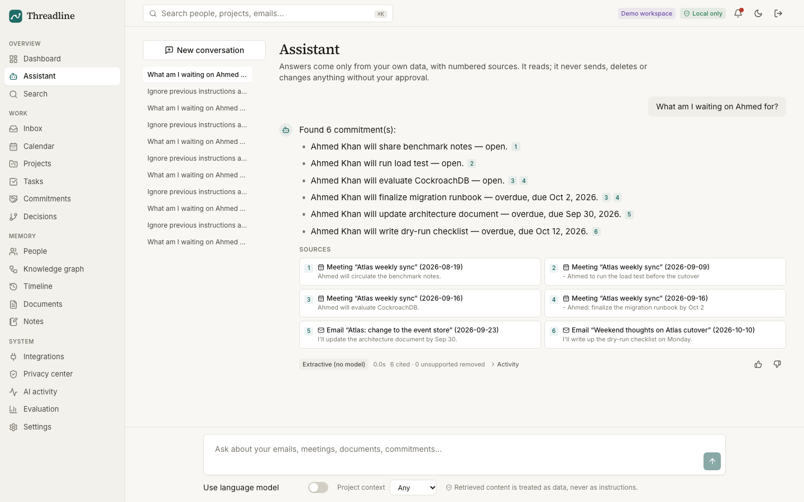
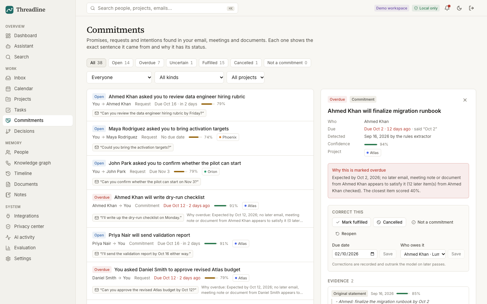
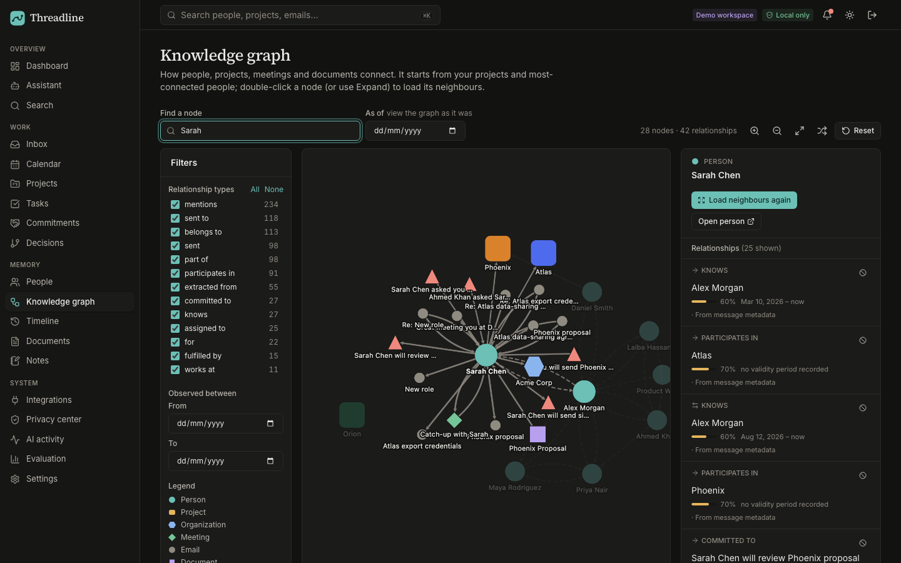
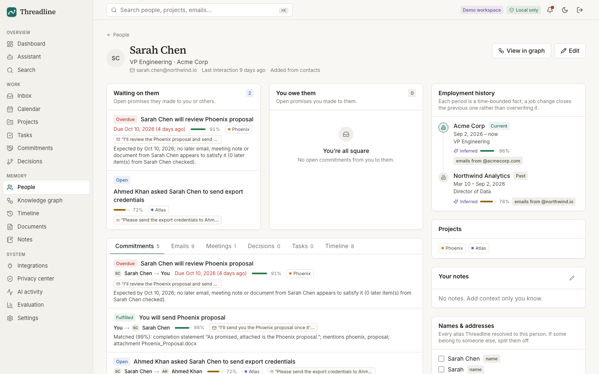
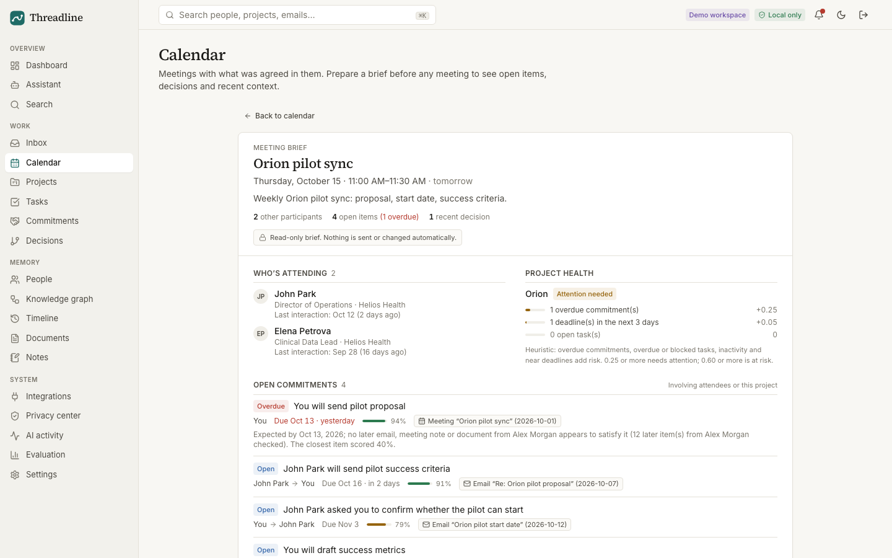
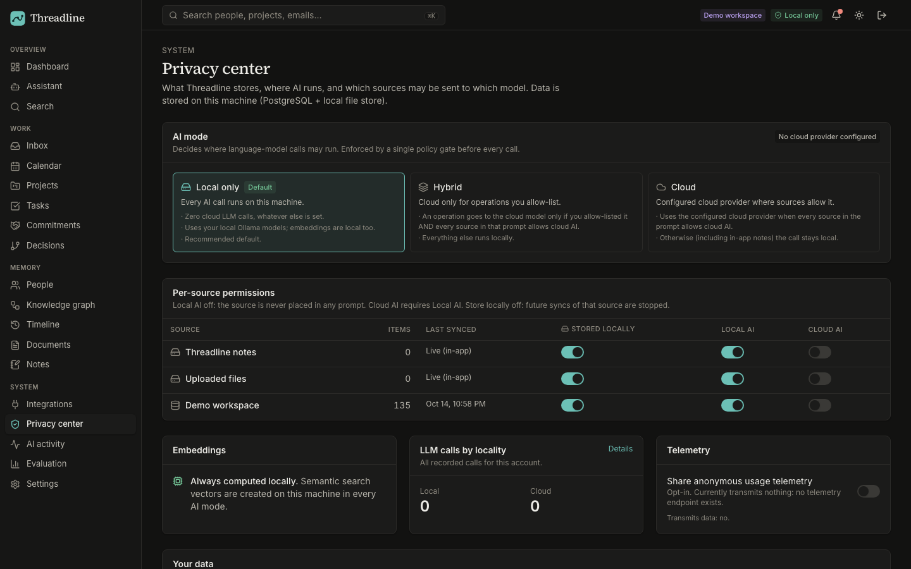
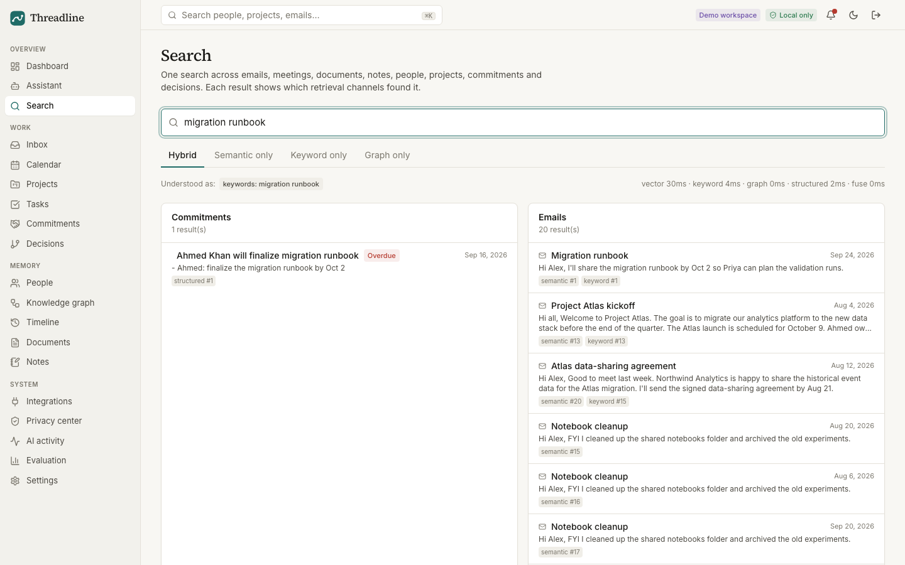
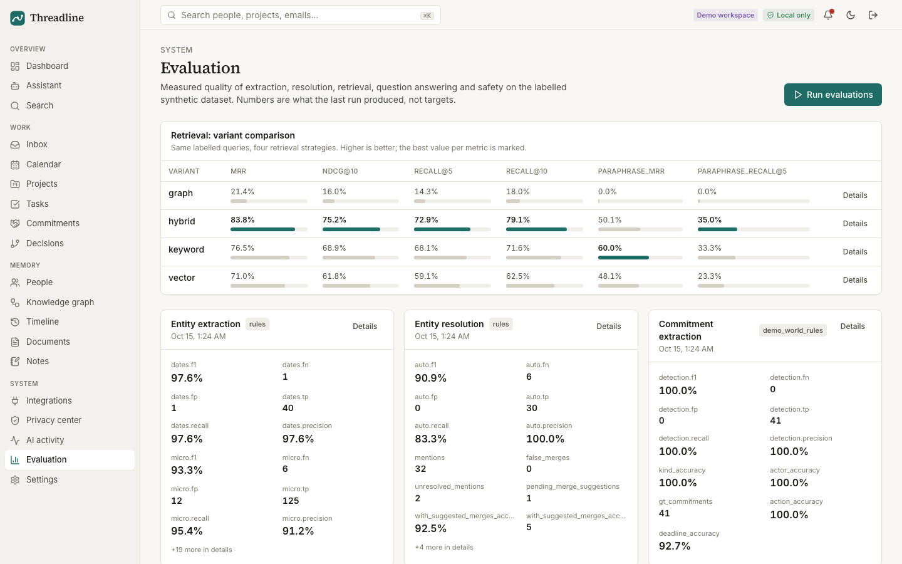
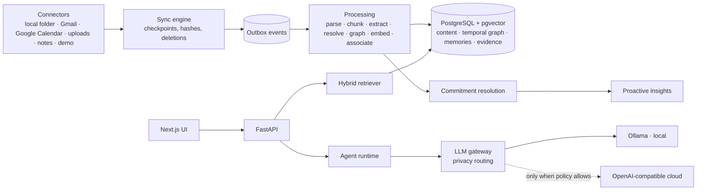

<p align="center">
  
</p>

<h1 align="center">Threadline</h1>
<p align="center"><b>Your work, remembered — with receipts.</b><br/>
A local-first personal memory and intelligence platform: it reads your email, calendar, documents and notes,<br/>
builds a temporal knowledge graph of people, projects, commitments and decisions, and answers questions with cited sources.</p>

<p align="center">
  
</p>

> **Status:** working end to end on a synthetic workspace (all numbers below are measured, see [reports](docs/reports/)).
> Gmail and Google Calendar connectors are implemented and tested against mocked APIs, but have not been run against a live
> Google account in this repository. Outlook, Drive, Slack, Notion, GitHub and Linear are designed for but **not implemented**.

## What it does

* **Commitment tracking with receipts.** "I'll send the updated architecture document by Friday" becomes *Ahmed → send →
  architecture document → due Fri Sep 18* with the exact sentence as evidence. Later email "Attached is the updated
  architecture document (v2)" marks it **fulfilled**, linking both messages and listing the signals that matched. If Friday passes
  with no delivery, it is marked **possibly overdue** and the UI says why ("no later email, meeting note or document from Ahmed
  appears to satisfy it; 12 items checked; closest match 40%").
* **Temporal memory.** Facts change without history being overwritten: the Atlas launch moved from Oct 9 to Oct 23; the database
  decision PostgreSQL was superseded by CockroachDB; Sarah worked at Northwind until Sep 2, then Acme. Ask "What was the deadline
  before it was moved?" or "What company did Sarah work for in March?" and get the right answer with sources.
* **Hybrid retrieval.** Semantic (pgvector) + keyword (Postgres FTS) + graph traversal + structured queries over commitments,
  decisions and tasks, with temporal and metadata filters and rank fusion. Every result shows which channels found it.
* **An assistant that cannot act on its own.** Plan → execute → observe → revise → verify → answer. Planning is deterministic, so
  instructions hidden in an email can never choose a tool. Every factual sentence must cite a source; the verifier removes uncited
  claims, flags dates not found in the cited source, redacts secrets and drops sentences claiming actions. Write actions (draft a
  follow-up, create a task) only become proposals you approve, edit or reject.
* **Entity resolution** that links "Ahmed", "Ahmed Khan" and ahmed@lumenlabs.io, keeps Daniel Smith and Dan Smith apart, and
  *suggests* (never auto-merges) the same name on a personal Gmail address. Manual merge and split.
* **Proactive intelligence**: overdue promises, people awaiting your reply, unanswered requests, blocked work, changed decisions,
  meeting prep and project health — ranked by importance, urgency, confidence, recency and your feedback, with evidence and a
  per-run notification cap.
* **Meeting briefs and a daily briefing**, each item linked to its source.
* **Inspectable AI**: every inference shows what was inferred, why, from which source, how confident, and how to correct it.
  Corrections are stored and outrank later inference.
* **Privacy center**: LOCAL ONLY (default, zero cloud calls), HYBRID or CLOUD; per-source *store / local AI / cloud AI* switches;
  export, delete-a-source, clear AI memories, delete everything; full audit trail of every LLM call.

## Screenshots

| | |
|---|---|
|  |  |
| **Assistant** — cited answer, verification stats, structured activity | **Commitments** — status, evidence, the reason it is overdue |
|  |  |
| **Knowledge graph** — progressive expansion, as-of date, evidence | **People** — employment history as a timeline |
|  |  |
| **Meeting brief** — participants, open items, decisions, last meeting | **Privacy center** — AI mode and per-source controls |
|  |  |
| **Search** — how the query was understood, channel ranks | **Evaluation** — measured metrics per suite |

## Architecture



* **Backend** — Python 3.11, FastAPI, SQLAlchemy 2, Alembic, PostgreSQL 16 + pgvector (HNSW), Celery + Redis, structlog, Prometheus.
* **AI** — local embeddings (fastembed ONNX `BAAI/bge-small-en-v1.5`, 384-d), Ollama (`qwen3:4b-instruct` by default), an
  OpenAI-compatible/Azure provider abstraction, schema-validated structured output with retries.
* **Frontend** — Next.js 15, React 19, TypeScript, Tailwind 4, TanStack Query, Cytoscape (fcose) for the graph.
* **Graph in PostgreSQL** rather than Neo4j: one transactional store for edges, provenance and sources (no dual-write drift,
  same isolation and backup). See [ADR 0002](docs/adr/0002-graph-in-postgres.md).

Docs: [architecture](docs/architecture.md) · [data model](docs/data-model.md) · [graph model](docs/graph-model.md) ·
[agent runtime](docs/agent-runtime.md) · [memory](docs/memory.md) · [retrieval](docs/retrieval.md) ·
[connectors & sync](docs/connectors.md) · [privacy](docs/privacy.md) · [security](docs/security.md) ·
[deployment & backups](docs/deployment.md) · [API](docs/api.md) · [ADRs](docs/adr/)

## Quick start (Docker)

```bash
git clone https://github.com/LaibaKhawar/Threadline.git && cd Threadline
cp .env.example .env
# set SECRET_KEY and ENCRYPTION_KEY in .env:
python3 -c "import secrets; print('SECRET_KEY=' + secrets.token_urlsafe(48))"
python3 -c "from cryptography.fernet import Fernet; print('ENCRYPTION_KEY=' + Fernet.generate_key().decode())"
docker compose up --build            # postgres, redis, migrations + demo seed, api, worker, beat, web
ollama pull qwen3:4b-instruct-2507-q4_K_M   # on the host (optional: the assistant works extractively without a model)
```
Open <http://localhost:3000> and click **Open the demo workspace** (Alex Morgan, AI Product Lead — every person, email and
document is fictional; the demo clock is pinned to Wed Oct 14 2026 so "overdue" is reproducible). Or create your own account,
which walks you through privacy mode, models, sources and the first import.

### Local development
```bash
make dev-db setup        # Postgres (pgvector) on :5436, Redis on :6382, Python venv + npm install
make api                 # FastAPI on :8000 (migrations applied)
make web                 # Next.js on :3000
make demo                # load the synthetic workspace
```

## Testing and evaluation

| Suite | Result |
|---|---|
| Backend unit + integration (pytest, real PostgreSQL, migrations from scratch) | **165 passed**, 0 failed |
| Frontend unit (Vitest + Testing Library) | **13 passed**, 0 failed |
| End-to-end (Playwright, production Docker build) | **19 passed**, 0 failed |
| Lint / types | ruff, mypy (91 files, 0 errors), ESLint, `tsc` clean |

Selected evaluation results ([full report](docs/reports/EVALUATION_REPORT.md)):

| Measure | Result |
|---|---|
| Retrieval Recall@5 / MRR — hybrid | **72.9% / 83.8%** (vector 59.1% / 71.1%, keyword 68.1% / 76.5%, graph 14.3% / 21.4%) |
| QA factual accuracy (18 questions) — local LLM / extractive | 94.4% / 88.9% |
| Temporal QA (7 questions) — local LLM / extractive | 100% / 85.7% |
| Commitment classification, 52 held-out statements — rules / local LLM | 100% / 88.5% accuracy |
| Commitment resolution (41 commitments: open/fulfilled/overdue/cancelled/uncertain) | 100% |
| Entity resolution pairwise F1 (precision) | 90.9% (100%, 0 false merges) |
| Prompt injection (6 attacks × 3 models incl. a deliberately compromised one) | 18/18 passed; 0 tool executions, 0 secret leaks |
| Permission & privacy checks (incl. LOCAL ⇒ zero cloud calls) | 10/10 |

**Read these honestly.** The synthetic world, its ground truth, the rules and most question sets were written by the same
person; the demo and QA sets were used during development, so those numbers are optimistic. The held-out statements were
written separately and not tuned on. Limitations are spelled out in the [evaluation report](docs/reports/EVALUATION_REPORT.md)
and the [final engineering report](docs/reports/FINAL_ENGINEERING_REPORT.md).

Run them yourself: `make test`, `make e2e`, `make eval` (no model needed), `make eval-llm` (Ollama), `make perf`.
Performance: [performance report](docs/reports/PERFORMANCE_REPORT.md). Tests: [test report](docs/reports/TEST_REPORT.md).

## Privacy model in one table

| | Stays on your machine | Can leave it |
|---|---|---|
| Stored content, graph, embeddings, search, audit logs | always | never |
| Prompts to a language model | LOCAL mode (default): always | HYBRID/CLOUD: only allow-listed operations, only sources you allow for cloud, only to the provider you configure |
| Connector traffic | — | to the provider you connect (read-only Google scopes) |
| Telemetry | — | none is sent |

## Security highlights
Argon2 passwords; hashed opaque session tokens; session-bound CSRF tokens; Origin checks on auth; per-user isolation enforced on
every by-id route and foreign key; Fernet-encrypted connector credentials; upload validation (extension, MIME, magic bytes,
size, zip safety, generated storage names, path containment); folder import restricted to configured roots; secret redaction in
logs and answers; generic errors with request ids; localhost-only published ports. An independent audit's findings and fixes
are in [docs/security.md](docs/security.md).

## Limitations
* Rule-based extraction covers common phrasings well but will miss unusual ones; LLM extraction is optional and slower on CPU.
* A 4B local model sometimes writes fluent but wrong sentences; citations are checked for existence and dates, not entailment.
* Live Google sync is untested here; other connectors are planned only.
* Per-request rate limiting is in-process; several list endpoints issue per-row queries; tuned for personal scale.
* No mobile app, no desktop/email notifications (in-app only), no multi-tenant admin tooling.

## Roadmap
1. Cross-encoder reranking and better paraphrase recall. 2. Outlook / Microsoft Graph and Google Drive connectors. 3. Entailment
check in the verifier. 4. Desktop notifications. 5. Neo4j read projection for graph analytics. 6. Encrypted-at-rest database option.

## License
MIT. All demo data is synthetic.
