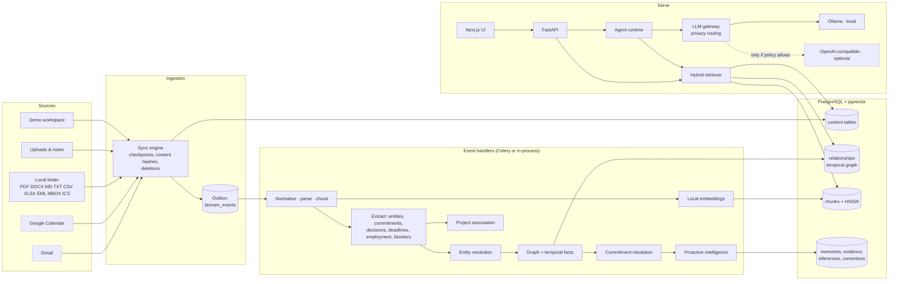

# System architecture

Threadline is a local-first personal memory platform. It ingests email, calendar, documents and notes,
turns them into a temporal knowledge graph with provenance, and answers questions with cited sources.
Everything below runs on one machine by default.



## Modules

| Module | Path | Responsibility |
|---|---|---|
| API gateway | `backend/app/main.py`, `api/` | HTTP, sessions, CSRF, rate limits, error mapping, security headers |
| Authentication | `api/routers/auth.py`, `core/security.py` | Argon2 passwords, opaque hashed session tokens, session-bound CSRF |
| Integration service / connectors | `connectors/` | Common `Connector` interface; local folder, Gmail, Google Calendar, demo; planned connectors listed honestly |
| Sync engine | `ingestion/sync.py` | Idempotent upserts by deterministic external id, change detection, checkpoints, deletions |
| Event bus | `domain/events.py`, `ingestion/handlers.py` | Transactional outbox; handlers are idempotent and retried; dead-lettering after 3 attempts |
| Document processor | `documents/` | Validation (extension, MIME, magic bytes, size, zip safety), structure-preserving parsers, chunking |
| Extraction | `extraction/` | Temporal expressions, people/orgs/projects, commitments/requests/intentions/completions, decisions, deadline moves, employment, blockers; optional LLM extractor |
| Entity resolution | `resolution/entity_resolution.py` | Scored identity matching, merge candidates, manual merge/split |
| Graph service | `memory/graph.py` | Temporal edges with provenance, functional relations, point-in-time queries |
| Memory engine | `memory/memories.py` | Semantic facts with supersession, episodic memories, procedural preferences, consolidation |
| Commitment resolution | `commitments/resolution.py` | Fulfilment, cancellation, overdue — with signals and explanations |
| Project intelligence | `intelligence/project_association.py`, `proactive.py` | Project association with reasons; health heuristic with listed signals |
| Proactive engine / notifications | `intelligence/proactive.py` | Detectors → ranked insights → rate-limited notifications |
| Briefings | `intelligence/briefs.py` | Daily briefing, meeting briefs |
| Retrieval | `retrieval/` | Query parsing, vector/keyword/graph/structured channels, weighted RRF |
| Agent runtime + tools | `agent/` | Plan → execute → observe → revise → verify → answer; permissioned tool registry |
| LLM gateway | `ai/llm/` | Provider abstraction (Ollama, OpenAI-compatible, Azure), privacy routing, cost and audit rows |
| Embeddings | `ai/embeddings/` | fastembed (ONNX bge-small), Ollama, deterministic hashing fallback |
| Workers | `workers/` | Celery tasks, beat schedule (proactive every 15 min, consolidation daily, stuck-event recovery) |
| Evaluation | `backend/evals/` | 10 suites over a synthetic world with ground truth; performance benchmark |

## Request path of a question

```mermaid
sequenceDiagram
  participant U as User
  participant API
  participant RT as Agent runtime
  participant QP as Query parser
  participant T as Read tools
  participant P as Privacy policy
  participant LLM as Local model
  participant V as Verifier
  U->>API: POST /api/assistant/ask
  API->>RT: run(question)
  RT->>QP: people, projects, time range, intents
  RT->>RT: PLAN (deterministic; from the question only)
  loop each planned tool
    RT->>T: execute (read-only, user-scoped)
  end
  RT->>RT: OBSERVE / REVISE (broaden once if evidence is thin)
  RT->>P: drop sources whose AI permission is off; route local vs cloud
  RT->>LLM: system rules + question + numbered sources (fenced as untrusted)
  LLM-->>RT: answer with [S#] citations
  RT->>V: check citations, uncited claims, dates, secrets, action claims
  V-->>API: answer + citations + steps + verification
```

If no model is reachable (or the user turns it off), an extractive composer answers from the same
structured tool results; every line still carries a citation.

## Key decisions

See `docs/adr/`. In short: the graph lives in PostgreSQL (one transactional store, shared isolation
and provenance); extraction is rule-first with an optional schema-validated LLM pass; planning is
deterministic so retrieved text can never choose a tool; embeddings are always local.
