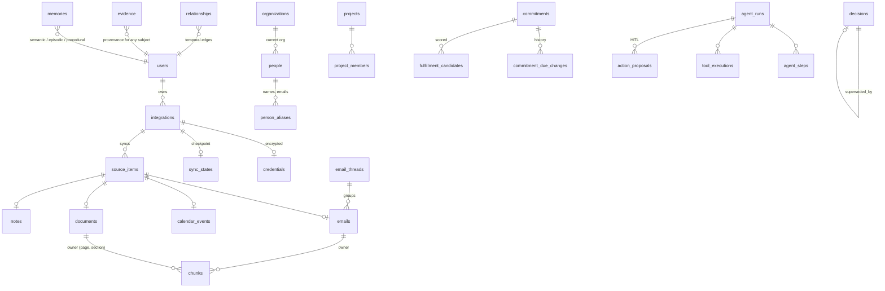

# Data model

All personal rows carry `user_id` (FK → users, `ON DELETE CASCADE`); every query filters on it.
Schema is managed by Alembic (`backend/alembic/versions/`); the test suite migrates down and up on every run.

| Layer | Tables |
|---|---|
| Identity | users, sessions (hashed tokens), user_settings (AI mode, models, clock override, procedural prefs) |
| Sources | integrations (per-source privacy flags), credentials (Fernet), sync_states, source_items (unique `(user, integration, external_id)`, content hash, `deleted_at`) |
| Content | email_threads, emails, calendar_events, event_participants, documents, notes, chunks (`vector(384)` + HNSW, generated `tsvector` + GIN) |
| Structured | people, person_aliases, merge_candidates, organizations, projects, project_members, topics, tasks, commitments, commitment_due_changes, fulfillment_candidates, decisions |
| Graph | relationships (`src_type/src_id`, `rel_type`, `dst_type/dst_id`, `valid_from/valid_to/observed_at`, `confidence`, `status`, `source_*`, `evidence_span`, `origin`) |
| Memory | memories, evidence, inferences, corrections, timeline_events |
| Agent | conversations, agent_runs, agent_steps, tool_executions, action_proposals |
| Ops | insights, notifications, llm_calls, audit_log, jobs, domain_events, evaluation_runs |

## Idempotency keys
Derived rows use deterministic `dedupe_key`s (hash of user, source, span offset and normalised content),
so reprocessing the same source never duplicates commitments, decisions, tasks, memories, insights,
notifications or timeline entries. Rows the user corrected (`user_modified`, `user_confirmed`) are never
overwritten by later extraction.
