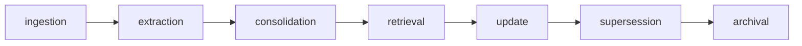

# Memory architecture

| Type | Where | Examples |
|---|---|---|
| Working | conversation + agent run | the last two Q/A pairs, inherited entities |
| Episodic | `memories(kind=episodic)`, `timeline_events` | meetings with notes, decisions, deadline moves, fulfilments |
| Semantic | `memories(kind=semantic)`, graph edges, typed tables | Sarah works at Acme from Sep 2; Atlas launch due Oct 23; database decision = CockroachDB |
| Procedural | `memories(kind=procedural, origin=user)` | "Always show evidence when summarizing project decisions" (only user-entered, injected into prompts as user preferences) |

Threadline never infers sensitive personal characteristics; extraction is limited to work entities.

## Lifecycle

* **Consolidation**: the same fact from two sources reinforces one memory (`reinforcement_count`); a promise
  restated in an email after a meeting becomes one commitment with two evidence rows; a decision restated in a
  later document is attached as `reaffirmed` evidence.
* **Supersession**: a different value for the same `(subject, attribute)` closes the old fact (`valid_to`) and
  links it (`superseded_by_id`). History stays queryable (`value_at`, "deadline before it moved").
* **Conflict**: two values can coexist when their validity differs; facts are ordered by validity, not arrival.
* **Archival**: low-confidence episodic memories older than 120 days are archived (not deleted) by the daily job.
* **Corrections**: user corrections are stored in `corrections` and outrank inference: project corrections become
  rules (per thread, document, note or recurring meeting title); rejected merges are never proposed again;
  commitments the user edited or set a status on are skipped by automatic resolution; user-edited commitments,
  confirmed decisions and user-edited tasks survive re-extraction and upstream edits, with their evidence.
